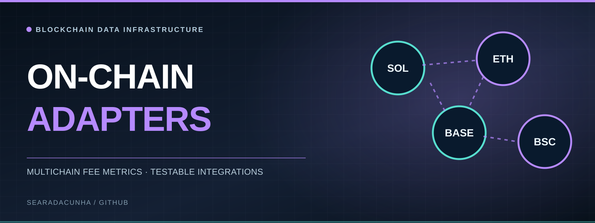

# Adapters

<p align="center"></p>

Find the instructions to list, write, test and submit an adapter [here](https://docs.llama.fi/list-your-project/other-dashboards)

## About this fork

This is a fork of [DefiLlama/dimension-adapters](https://github.com/DefiLlama/dimension-adapters). Everything outside the items below comes from upstream unchanged, synced with `git merge`.

Work done in this fork:

- `fees/solana.ts`: the leader's share of transaction fees is booked as `dailySupplySideRevenue`, so Fees = Revenue + SupplySideRevenue, and the burn of half the priority fee stops at the SIMD-0096 activation slot (320,112,000, 2025-02-12 06:59:08 UTC) instead of midnight. The evidence, block by block, and the refill notes are in [pull request #3](https://github.com/searadacunha/dimension-adapters/pull/3).
- Tests for that adapter, run by `.github/workflows/fork-solana-fees.yml`: `tests/fees-solana.test.ts` (offline, the Allium query is replaced by fixed rows) and `tests/solana-fee-split.live.test.ts` (real blocks read from the public Solana RPC).
- Upstream pull request: [Polymarket taker volume, DefiLlama/dimension-adapters#10933](https://github.com/DefiLlama/dimension-adapters/pull/10933).

```
pnpm i
node --test -r ts-node/register/transpile-only tests/fees-solana.test.ts tests/solana-fee-split.live.test.ts
```

## Install dependencies

`pnpm i`

## test adapter commands

`pnpm test fees bitcoin`

`pnpm test fees bitcoin 2025-10-10`

Run only specific chains (5th argument):

`pnpm test fees cctp 2026-08-01 solana`

Multiple chains (comma-separated):

`pnpm test fees cctp 2026-08-01 stellar,solana`

On PowerShell, quote the chain list so the comma is not treated as an argument separator:

`pnpm test fees cctp 2026-08-01 "stellar,solana"`

## Adding custom RPC URLs

Create an `.env` file and add custom RPC URLs using the `{CHAIN}_RPC` format (use uppercase chain name):

```
ETHEREUM_RPC="https://yourcustomrpc.com"
```
